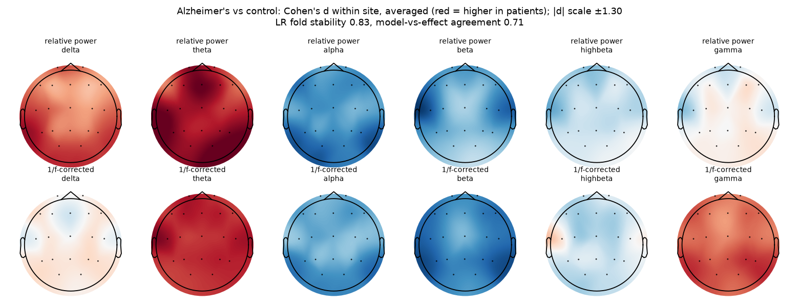
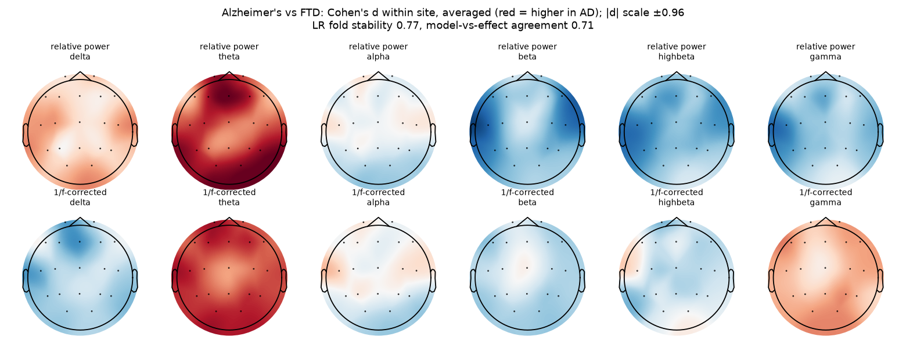

# Alzheimer's disease

Branch `disease/alzheimers` of the Brain Signal Processing project. The code is shared with master (`eeg/` package); this page collects everything about this disease. Every number below comes from `results/` and every person is tested by models that never saw them.

Alzheimer's disease (AD) is the most common dementia. Its best-known EEG sign is 'slowing': more slow theta and delta activity and less alpha and beta.

## Datasets

| Dataset | Patients | Controls |
|---|---|---|
| BrainLat (Argentina, Chile) - AD vs healthy | 35 patients | 32 healthy |
| Thessaloniki (Greece) - AD vs healthy | 36 patients | 29 healthy |
| BrainLat (Argentina, Chile) - AD vs FTD | 35 AD | 19 FTD |
| Thessaloniki (Greece) - AD vs FTD | 36 AD | 23 FTD |

## Final system results

Five frozen members (scale-free inputs), mean-rank ensemble, cross-fitted Platt calibration (`eeg/experiments/final_system.py`). AUC with 95% bootstrap CI.

| Task - hospital | Ensemble AUC | Logistic regression | Riemannian (scale-free) | GATv2 | Graph Transformer | LaBraM fine-tuned |
|---|---|---|---|---|---|---|
| AD vs healthy - BrainLat (Argentina, Chile) | **0.75 [0.62-0.86]** | 0.72 | 0.70 | 0.69 | 0.72 | 0.75 |
| AD vs healthy - Thessaloniki (Greece) | **0.94 [0.87-0.99]** | 0.92 | 0.88 | 0.94 | 0.91 | 0.89 |
| AD vs FTD - BrainLat (Argentina, Chile) | **0.86 [0.75-0.95]** | 0.86 | 0.76 | 0.79 | 0.76 | 0.71 |
| AD vs FTD - Thessaloniki (Greece) | **0.71 [0.57-0.84]** | 0.63 | 0.74 | 0.71 | 0.67 | 0.60 |

**Answer only when confident** (accuracy on the people the system answers, all hospitals):

| Task | all | 90% | 80% | 70% | 60% | 50% | Brier | ECE |
|---|---|---|---|---|---|---|---|---|
| AD vs healthy | 77% | 80% | 82% | 88% | 89% | 91% | 0.169 | 0.123 |
| AD vs FTD | 68% | 70% | 71% | 73% | 76% | 82% | 0.197 | 0.116 |

## What the model looks at

**AD vs healthy** - fold stability 0.83, agreement with effect sizes 0.71. Largest within-hospital effects (Cohen's d):

- rel theta Fz: +1.30 (same sign at 100% of hospitals)
- rel theta O2: +1.28 (same sign at 100% of hospitals)
- rel theta T6: +1.23 (same sign at 100% of hospitals)
- rel theta T5: +1.23 (same sign at 100% of hospitals)
- rel theta T3: +1.23 (same sign at 100% of hospitals)



**AD vs FTD** - fold stability 0.77, agreement with effect sizes 0.71. Largest within-hospital effects (Cohen's d):

- rel theta Fz: +0.96 (same sign at 100% of hospitals)
- rel theta O2: +0.87 (same sign at 100% of hospitals)
- rel theta Fp1: +0.85 (same sign at 100% of hospitals)
- rel theta T6: +0.83 (same sign at 100% of hospitals)
- per theta Fp1: +0.82 (same sign at 100% of hospitals)



## How the results evolved

| Stage | AD vs healthy - Thessaloniki | AD vs FTD - Thessaloniki |
|---|---|---|
| Within one dataset (Ensemble v2, Nov 5) | 0.92 | 0.58 |
| Master model, before preprocessing v2 | 0.91 | 0.68 |
| Final system (Nov 13) | 0.94 | 0.71 |
| Same model with leaky window-level split (for comparison only) | 1.00 | 1.00 |

The leaky row shows what mixing a person's windows into both training and test gives: the model recognises people, not disease. It is not a valid result.

## Caveats

- BrainLat patients and controls were exported as different file types (about 4x lower amplitude in controls). All inputs are scale-free, but treat BrainLat AD vs healthy with caution. AD vs FTD on BrainLat is unaffected (both patient groups share the file type).
- Thessaloniki is a single hospital; its 0.94 is a within-cohort result.

## Run only this disease

From the repository root, with the feature cache in `$OUT`:

```bash
python -m eeg.data.raw_eeg features --out $OUT --datasets brainlat ds004504
python -m eeg.data.prep_v2 extract --out $OUT --datasets brainlat ds004504
python -m eeg.experiments.final_system --out $OUT --tasks alzheimers,alzheimers_vs_ftd
python -m eeg.experiments.explain_final --out $OUT        # writes all diseases
```

Full write-up: `docs/MiniProject_Results.docx` and the project report; model settings: `docs/MODEL_REGISTRY.md`.
