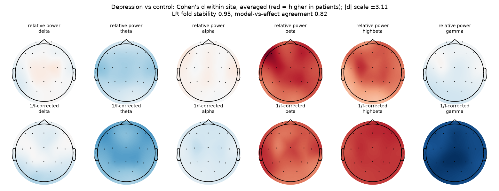

# Depression (major depressive disorder)

Branch `disease/depression` of the Brain Signal Processing project. The code is shared with master (`eeg/` package); this page collects everything about this disease. Every number below comes from `results/` and every person is tested by models that never saw them.

Major depressive disorder (MDD). The final system uses the Mumtaz dataset (clinically diagnosed patients and healthy controls).

## Datasets

| Dataset | Patients | Controls |
|---|---|---|
| Mumtaz (Malaysia) - Depression vs healthy | 30 patients | 28 healthy |

## Final system results

Five frozen members (scale-free inputs), mean-rank ensemble, cross-fitted Platt calibration (`eeg/experiments/final_system.py`). AUC with 95% bootstrap CI.

| Task - hospital | Ensemble AUC | Logistic regression | Riemannian (scale-free) | GATv2 | Graph Transformer | LaBraM fine-tuned |
|---|---|---|---|---|---|---|
| Depression vs healthy - Mumtaz (Malaysia) | **0.97 [0.91-1.00]** | 0.95 | 0.91 | 0.97 | 0.95 | 0.96 |

**Answer only when confident** (accuracy on the people the system answers, all hospitals):

| Task | all | 90% | 80% | 70% | 60% | 50% | Brier | ECE |
|---|---|---|---|---|---|---|---|---|
| Depression vs healthy | 93% | 94% | 93% | 95% | 97% | 97% | 0.133 | 0.265 |

## What the model looks at

**Depression vs healthy** - fold stability 0.95, agreement with effect sizes 0.82. Largest within-hospital effects (Cohen's d):

- per gamma Pz: -3.11 (same sign at 100% of hospitals)
- per gamma P3: -3.06 (same sign at 100% of hospitals)
- per gamma Cz: -3.00 (same sign at 100% of hospitals)
- per gamma P4: -2.99 (same sign at 100% of hospitals)
- per gamma O1: -2.97 (same sign at 100% of hospitals)



## How the results evolved

| Stage | Depression - Mumtaz |
|---|---|
| Within one dataset (Ensemble v2, Nov 5) | 0.97 |
| Master model, before preprocessing v2 | - |
| Final system (Nov 13) | 0.97 |
| Same model with leaky window-level split (for comparison only) | 1.00 |

The leaky row shows what mixing a person's windows into both training and test gives: the model recognises people, not disease. It is not a valid result.

## Caveats

- Mumtaz controls have far more 44 Hz power than patients (log10 3.63 vs 1.88): a low-pass filter applied to one group. Using only 1-25 Hz the score is 0.95 - quote this number, not the full-band one.
- Single dataset (58 people): generalisation to other hospitals is untested. UNM (ds003478) was dropped because its labels came from a questionnaire - only 11 of 46 'depressed' students had depression confirmed by clinical interview.
- The calibration error is high (58 people are too few to fit a calibrator); ranking and accuracy are fine.

## Run only this disease

From the repository root, with the feature cache in `$OUT`:

```bash
python -m eeg.data.raw_eeg features --out $OUT --datasets mumtaz
python -m eeg.data.prep_v2 extract --out $OUT --datasets mumtaz
python -m eeg.experiments.final_system --out $OUT --tasks mood
python -m eeg.experiments.explain_final --out $OUT        # writes all diseases
```

Full write-up: `docs/MiniProject_Results.docx` and the project report; model settings: `docs/MODEL_REGISTRY.md`.
