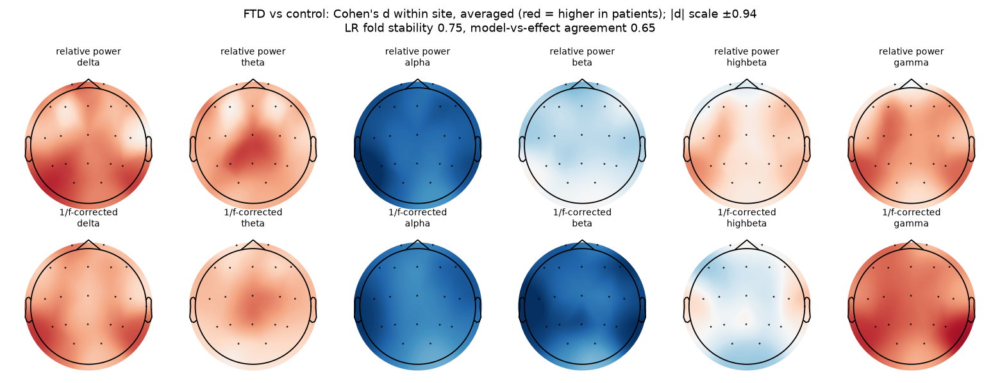
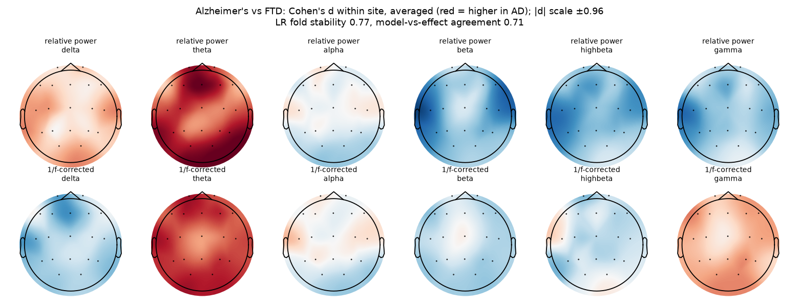

# Frontotemporal dementia

Branch `disease/ftd` of the Brain Signal Processing project. The code is shared with master (`eeg/` package); this page collects everything about this disease. Every number below comes from `results/` and every person is tested by models that never saw them.

Frontotemporal dementia (FTD, behavioural variant here) affects the frontal and temporal lobes. Its EEG changes are milder than Alzheimer's, which is why the two are hard to tell apart.

## Datasets

| Dataset | Patients | Controls |
|---|---|---|
| BrainLat (Argentina, Chile) - FTD vs healthy | 19 patients | 32 healthy |
| Thessaloniki (Greece) - FTD vs healthy | 23 patients | 29 healthy |
| BrainLat (Argentina, Chile) - AD vs FTD | 35 AD | 19 FTD |
| Thessaloniki (Greece) - AD vs FTD | 36 AD | 23 FTD |

## Final system results

Five frozen members (scale-free inputs), mean-rank ensemble, cross-fitted Platt calibration (`eeg/experiments/final_system.py`). AUC with 95% bootstrap CI.

| Task - hospital | Ensemble AUC | Logistic regression | Riemannian (scale-free) | GATv2 | Graph Transformer | LaBraM fine-tuned |
|---|---|---|---|---|---|---|
| FTD vs healthy - BrainLat (Argentina, Chile) | **0.64 [0.49-0.79]** | 0.69 | 0.65 | 0.60 | 0.60 | 0.54 |
| FTD vs healthy - Thessaloniki (Greece) | **0.89 [0.78-0.97]** | 0.79 | 0.86 | 0.84 | 0.91 | 0.77 |
| AD vs FTD - BrainLat (Argentina, Chile) | **0.86 [0.75-0.95]** | 0.86 | 0.76 | 0.79 | 0.76 | 0.71 |
| AD vs FTD - Thessaloniki (Greece) | **0.71 [0.57-0.84]** | 0.63 | 0.74 | 0.71 | 0.67 | 0.60 |

**Answer only when confident** (accuracy on the people the system answers, all hospitals):

| Task | all | 90% | 80% | 70% | 60% | 50% | Brier | ECE |
|---|---|---|---|---|---|---|---|---|
| FTD vs healthy | 73% | 72% | 73% | 74% | 79% | 79% | 0.202 | 0.104 |
| AD vs FTD | 68% | 70% | 71% | 73% | 76% | 82% | 0.197 | 0.116 |

## What the model looks at

**FTD vs healthy** - fold stability 0.75, agreement with effect sizes 0.65. Largest within-hospital effects (Cohen's d):

- per beta T3: -0.94 (same sign at 100% of hospitals)
- rel alpha T5: -0.92 (same sign at 100% of hospitals)
- per beta T5: -0.89 (same sign at 100% of hospitals)
- per beta F8: -0.89 (same sign at 100% of hospitals)
- per beta P3: -0.85 (same sign at 100% of hospitals)



**AD vs FTD** - fold stability 0.77, agreement with effect sizes 0.71. Largest within-hospital effects (Cohen's d):

- rel theta Fz: +0.96 (same sign at 100% of hospitals)
- rel theta O2: +0.87 (same sign at 100% of hospitals)
- rel theta Fp1: +0.85 (same sign at 100% of hospitals)
- rel theta T6: +0.83 (same sign at 100% of hospitals)
- per theta Fp1: +0.82 (same sign at 100% of hospitals)



## How the results evolved

| Stage | FTD vs healthy - Thessaloniki | AD vs FTD - Thessaloniki |
|---|---|---|
| Within one dataset (Ensemble v2, Nov 5) | 0.85 | 0.58 |
| Master model, before preprocessing v2 | 0.81 | 0.68 |
| Final system (Nov 13) | 0.89 | 0.71 |
| Same model with leaky window-level split (for comparison only) | 1.00 | 1.00 |

The leaky row shows what mixing a person's windows into both training and test gives: the model recognises people, not disease. It is not a valid result.

## Caveats

- BrainLat FTD vs healthy carries the same file-type caveat as BrainLat AD vs healthy.
- Only 23 FTD patients in Thessaloniki and 19 in BrainLat, so confidence intervals are wide.
- Most three-class errors are FTD classified as AD.

## Run only this disease

From the repository root, with the feature cache in `$OUT`:

```bash
python -m eeg.data.raw_eeg features --out $OUT --datasets brainlat ds004504
python -m eeg.data.prep_v2 extract --out $OUT --datasets brainlat ds004504
python -m eeg.experiments.final_system --out $OUT --tasks ftd,alzheimers_vs_ftd
python -m eeg.experiments.explain_final --out $OUT        # writes all diseases
```

Full write-up: `docs/MiniProject_Results.docx` and the project report; model settings: `docs/MODEL_REGISTRY.md`.
