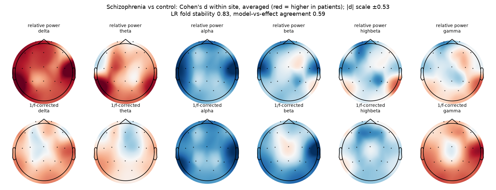

# Schizophrenia

Branch `disease/schizophrenia` of the Brain Signal Processing project. The code is shared with master (`eeg/` package); this page collects everything about this disease. Every number below comes from `results/` and every person is tested by models that never saw them.

Schizophrenia, from three hospitals: ASEEG (Iran), Warsaw (Poland) and Semmelweis (Hungary). One model is trained on all three together.

## Datasets

| Dataset | Patients | Controls |
|---|---|---|
| ASEEG (Iran) - Schizophrenia vs healthy | 51 patients | 50 healthy |
| Semmelweis (Hungary) - Schizophrenia vs healthy | 30 patients | 41 healthy |
| Warsaw (Poland) - Schizophrenia vs healthy | 14 patients | 14 healthy |

## Final system results

Five frozen members (scale-free inputs), mean-rank ensemble, cross-fitted Platt calibration (`eeg/experiments/final_system.py`). AUC with 95% bootstrap CI.

| Task - hospital | Ensemble AUC | Logistic regression | Riemannian (scale-free) | GATv2 | Graph Transformer | LaBraM fine-tuned |
|---|---|---|---|---|---|---|
| Schizophrenia vs healthy - ASEEG (Iran) | **0.84 [0.76-0.91]** | 0.77 | 0.81 | 0.80 | 0.70 | 0.79 |
| Schizophrenia vs healthy - Semmelweis (Hungary) | **0.67 [0.53-0.79]** | 0.68 | 0.59 | 0.53 | 0.51 | 0.68 |
| Schizophrenia vs healthy - Warsaw (Poland) | **0.82 [0.63-0.96]** | 0.84 | 0.87 | 0.78 | 0.70 | 0.56 |

**Answer only when confident** (accuracy on the people the system answers, all hospitals):

| Task | all | 90% | 80% | 70% | 60% | 50% | Brier | ECE |
|---|---|---|---|---|---|---|---|---|
| Schizophrenia vs healthy | 70% | 72% | 73% | 76% | 79% | 84% | 0.199 | 0.071 |

## What the model looks at

**Schizophrenia vs healthy** - fold stability 0.83, agreement with effect sizes 0.59. Largest within-hospital effects (Cohen's d):

- rel delta T4: +0.53 (same sign at 100% of hospitals)
- rel alpha T4: -0.51 (same sign at 100% of hospitals)
- rel delta T5: +0.47 (same sign at 100% of hospitals)
- per beta T4: -0.47 (same sign at 100% of hospitals)
- per alpha T4: -0.47 (same sign at 67% of hospitals)



## How the results evolved

| Stage | ASEEG | Warsaw | Semmelweis |
|---|---|---|---|
| Within one dataset (Ensemble v2, Nov 5) | 0.83 | 0.70 | 0.68 |
| Master model, before preprocessing v2 | 0.81 | 0.67 | 0.67 |
| Final system (Nov 13) | 0.84 | 0.82 | 0.67 |
| Same model with leaky window-level split (for comparison only) | 1.00 | 1.00 | 1.00 |

The leaky row shows what mixing a person's windows into both training and test gives: the model recognises people, not disease. It is not a valid result.

## Caveats

- Semmelweis has only about 2 minutes of eyes-closed EEG per person (median 12 windows), which caps its score (0.67).
- The hospital is easier to predict than the disease (site probe up to 0.96 balanced accuracy); a model trained at one hospital was at chance at another, so leave-one-hospital-out is not solved.

## Run only this disease

From the repository root, with the feature cache in `$OUT`:

```bash
python -m eeg.data.raw_eeg features --out $OUT --datasets aseeg semmelweis warsaw
python -m eeg.data.prep_v2 extract --out $OUT --datasets aseeg semmelweis warsaw
python -m eeg.experiments.final_system --out $OUT --tasks schizophrenia
python -m eeg.experiments.explain_final --out $OUT        # writes all diseases
```

Full write-up: `docs/MiniProject_Results.docx` and the project report; model settings: `docs/MODEL_REGISTRY.md`.
